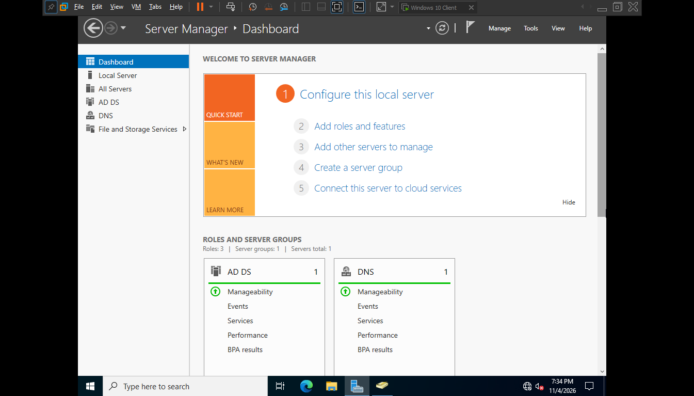
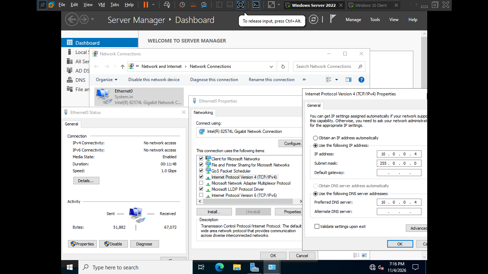
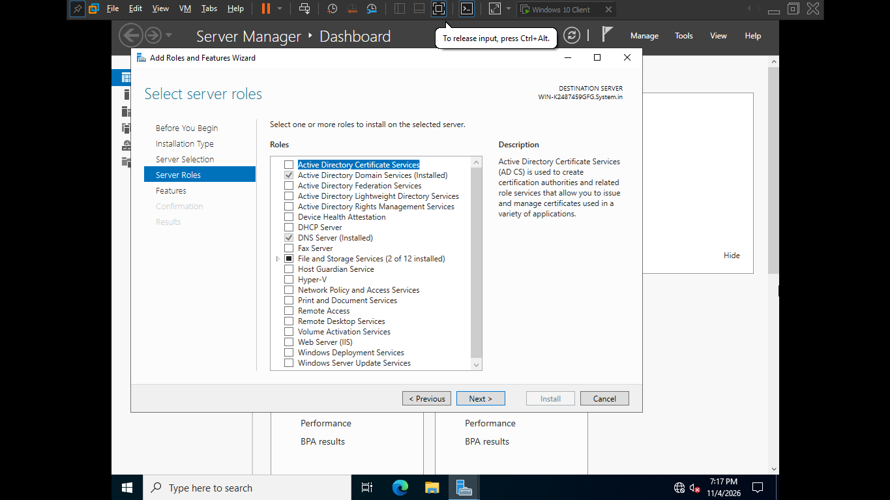
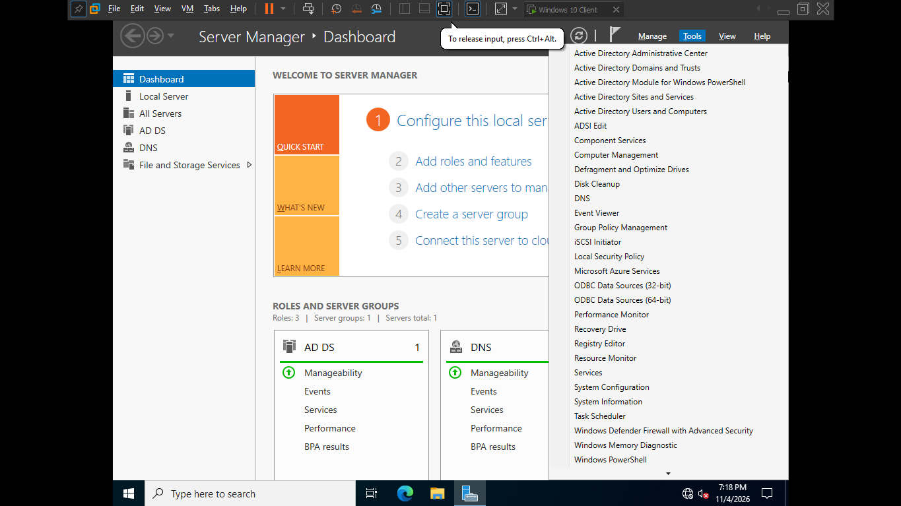
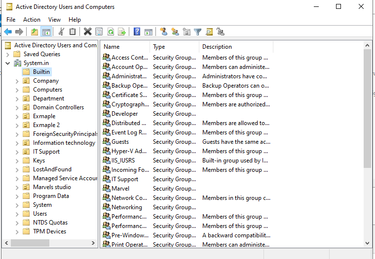
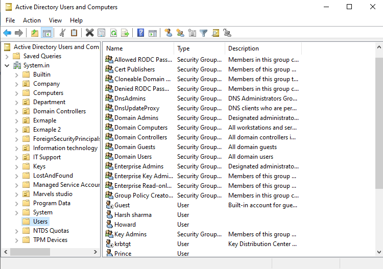
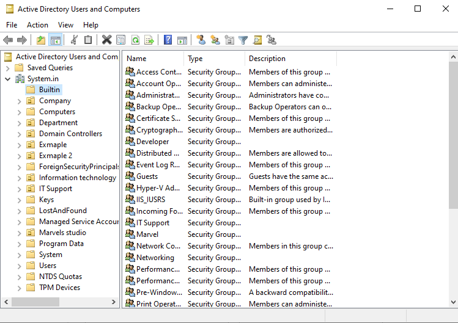

# Day 01: Active Directory Setup

**Date:** 05 Nov 2026
**Tools:** VMware Workstation, Windows Server 2022, Windows 10 Pro

## Goal
Build a domain environment, join a client to it, and practice basic user administration.

## Steps

### 1. Server Manager

### 2. Static IP configuration
Gave the server and the client static IPs on the same subnet. The client's DNS points to the server.

### 3. Install AD DS and promote to Domain Controller
Installed the AD DS role and DNS, then promoted the server to a domain controller (domain: System.in).

### 4. Active Directory tools

### 5. Active Directory Users and Computers

### 6. Users

### 7. Groups

### 8. Organizational Units
Created a Company OU with HR, IT, Sales, Groups and Computers inside it.
.png)

### 9. Joined the Windows 10 client to the domain
Used `sysdm.cpl`, then Change, then Domain, and signed in with the admin account.

### 10. User administration
Logged in with a domain user, then practiced reset password, unlock, disable, enable and delete.

## What I learned
- How a client finds the domain through DNS
- How OUs organize users and computers
- How to manage the account lifecycle

