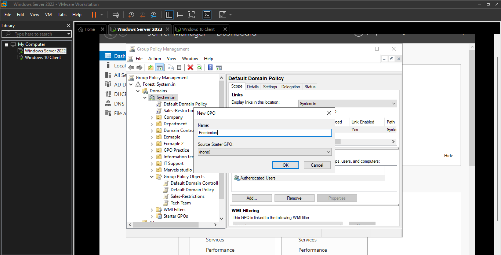
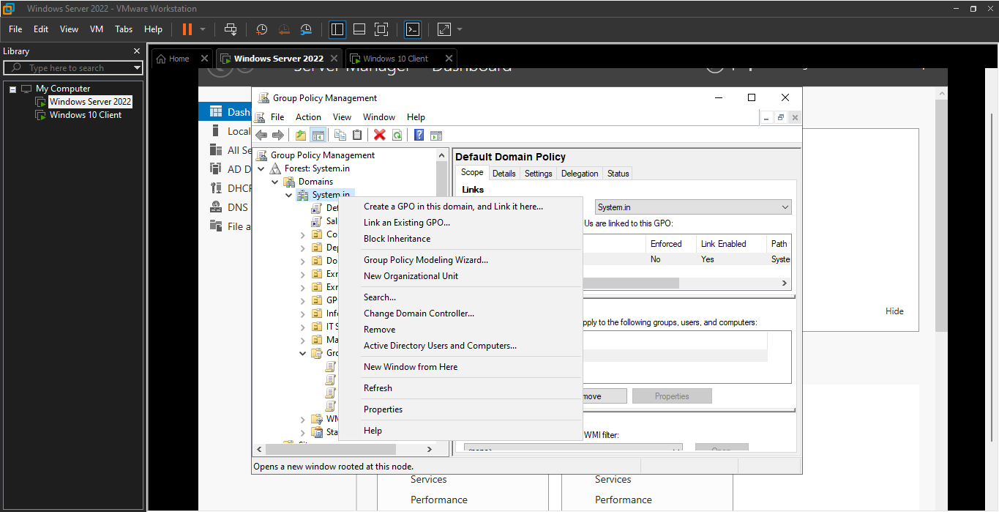
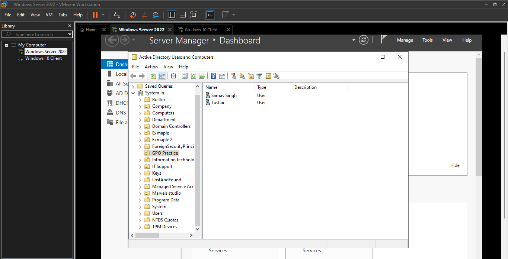
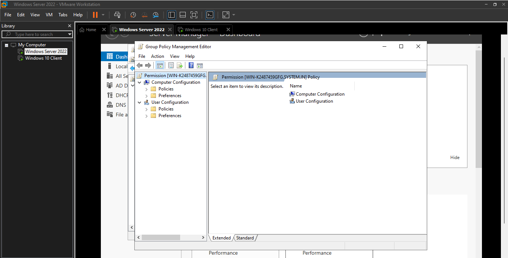
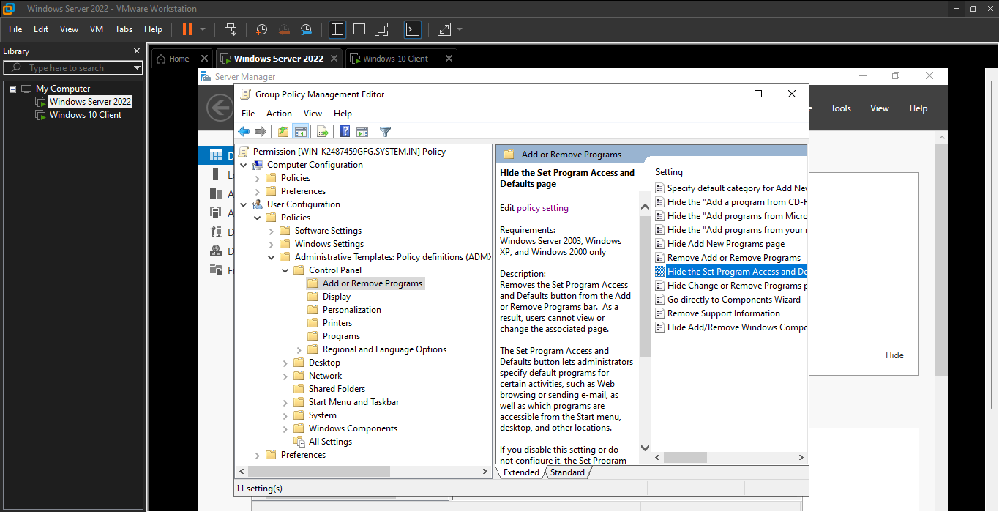
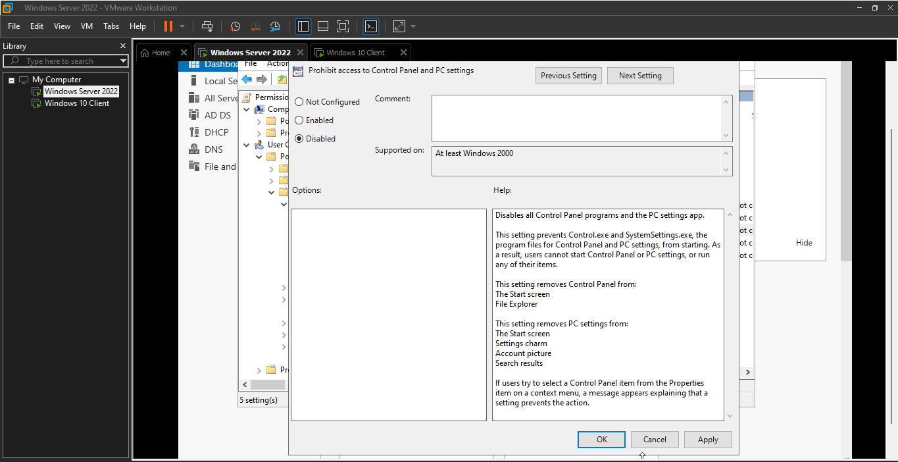
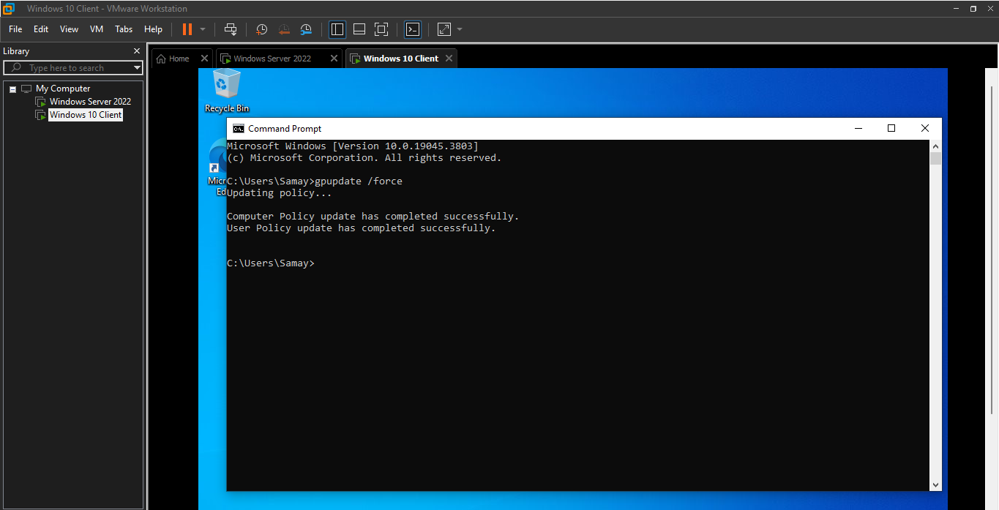
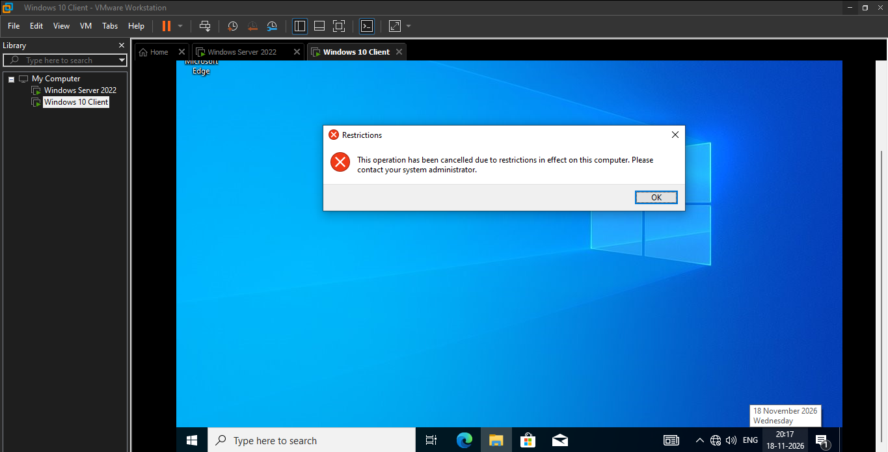

# Day 02: Group Policy

**Date:** 18 Nov 2026
**Tools:** Windows Server 2022, Windows 10 Pro, Group Policy Management

## Goal
Create a Group Policy Object (GPO), link it to an OU, and confirm it works on a domain client.

## Steps

### 1. Open Group Policy Management.

### 2. Create GPO 
Created a GPO named Permission.

### 3. Create a User Inside Organization unit.
Create a User Inside Organization unit.

### 4. Click Edit Open Group Policy Management Editor.
Open Group Policy Management Editor.

### 5. Group Policy Configuration.
Group Policy User Configuration.

### 6. Group Policy Apply.
Apply Configuration to the Group Policy.

### 7. Policy Update Command.
Group Policy Apply Update Command.

### 8. Group Policy Check.
Group Policy Check.

## What I learned
- A GPO applies to the users and computers in the OU it is linked to
- `gpupdate /force` refreshes policy without waiting

